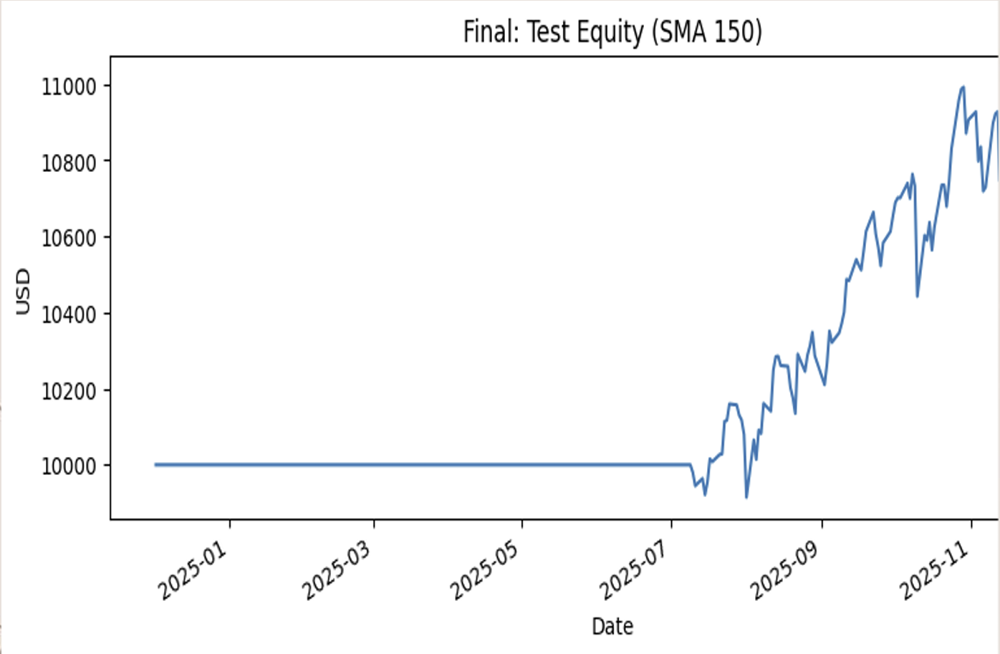
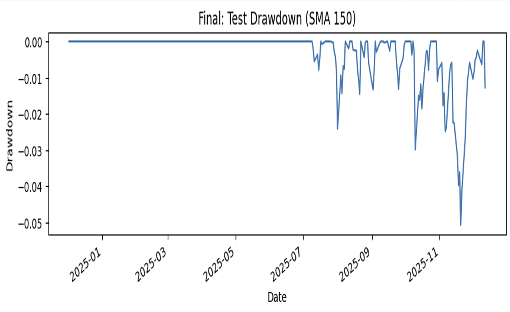

# Risk-Adjusted Time-Series Trading Strategy

**Python | Financial Time Series | Quantitative Analysis | Backtesting | Risk Management**

A Python-based quantitative finance project that develops and evaluates a rule-based trend-following strategy using historical SPY (S&P 500 ETF) market data.

The project compares two Simple Moving Average (SMA) strategies and evaluates their out-of-sample performance using risk-adjusted financial metrics.

## Project Overview

The objective of this project was to design and evaluate a systematic trading strategy that balances profitability with risk management.

The analysis uses historical SPY price data, chronological training and testing periods, transaction cost assumptions, and quantitative performance metrics to assess trading performance.

### Project Objectives

- Develop a rule-based trend-following trading strategy.
- Compare 150-day and 200-day Simple Moving Average indicators.
- Evaluate performance on out-of-sample historical data.
- Incorporate transaction costs into the backtesting process.
- Assess profitability, volatility-adjusted returns, and capital drawdowns.

## Technology Stack

- **Programming Language:** Python
- **Development Environment:** Jupyter Notebook
- **Market Data:** Yahoo Finance via `yfinance`
- **Data Analysis:** Pandas and NumPy
- **Visualization:** Matplotlib
- **Financial Analysis:** Time-series analysis, backtesting, and performance evaluation

## Dataset and Methodology

**Financial Instrument:** SPY — SPDR S&P 500 ETF Trust

**Data Source:** Yahoo Finance

The project uses historical market data downloaded programmatically rather than a separately stored dataset.

### Data Splitting

| Dataset | Period | Purpose |
|---|---|---|
| Training | December 2022 – December 2024 | Strategy development and SMA selection |
| Testing | December 2024 – December 2025 | Out-of-sample strategy evaluation |

The chronological split is intended to separate strategy development from final performance evaluation.

### Trading Assumptions

- Initial investment: **$10,000**
- Transaction costs: **0.2% per transaction**
- Strategy type: Long-only trend following
- Positioning: Invested in SPY or holding cash

## Trading Strategy

The strategy uses a Simple Moving Average to identify market trends.

### Trading Rules

**Buy / Hold SPY:** When the market price is above the selected SMA.

**Sell / Hold Cash:** When the market price falls below the selected SMA.

Two configurations were evaluated:

- **SMA 200:** A slower-moving baseline designed to capture longer-term trends.
- **SMA 150:** A faster-moving alternative intended to respond more quickly to market changes.

## Performance Evaluation

The project evaluated the strategies using three primary metrics:

- **Compound Annual Growth Rate (CAGR):** Annualized investment growth.
- **Sharpe Ratio:** Return relative to volatility.
- **Maximum Drawdown:** Largest peak-to-trough decline in portfolio equity.

### Reported Out-of-Sample Results

| Metric | SMA 200 | SMA 150 |
|---|---:|---:|
| CAGR | 2.2% | 8.6% |
| Sharpe Ratio | 0.40 | 1.17 |
| Maximum Drawdown | -5.1% | -5.1% |

*These figures are reported in the original academic project presentation and have not been independently reproduced for this repository.*

Under the project's stated evaluation criteria, SMA 150 met the return, Sharpe ratio, and maximum drawdown targets.

## Strategy Visualizations

### SMA 150 — Equity Curve



The equity curve illustrates the reported portfolio value over the test period, starting from an initial capital allocation of $10,000.

### SMA 150 — Drawdown Analysis



The drawdown chart illustrates declines in portfolio value relative to previous equity peaks during the test period.

Both charts show the SMA 150 strategy.

## How to Run the Project

### 1. Install Python Dependencies

Install the libraries required by the notebook:

```bash
pip install numpy pandas matplotlib yfinance jupyter
```

### 2. Open the Jupyter Notebook

```bash
jupyter notebook
```

Open:

`FinalProject_Code.ipynb`

### 3. Execute the Notebook

Run the notebook cells in order to retrieve historical market data, calculate trading indicators, evaluate strategy performance, and generate visualizations.

An internet connection is required to download historical prices through Yahoo Finance.

Results may vary with data revisions, package versions, and execution dates.

## Project Limitations

- The analysis evaluates historical market performance and does not guarantee future returns.
- The project focuses on one financial instrument, SPY.
- Transaction costs are modeled using a fixed assumption.
- The backtest does not capture every real-world trading friction.
- The strategy is evaluated over a limited out-of-sample period.
- Moving-average calculations and backtesting assumptions should be reviewed before applying the methodology to live trading.

## Future Improvements

- Evaluate additional moving-average configurations.
- Compare performance across different market regimes.
- Introduce volatility-based trading filters.
- Expand testing to multiple assets.
- Explore alternative trend-following indicators.
- Conduct more extensive robustness and sensitivity testing.

## Academic Project

**Project Type:** Academic group project

**Subject Area:** Analytics Programming / Quantitative Financial Analysis

This project demonstrates practical applications of Python programming, financial data analysis, systematic strategy evaluation, and risk-adjusted performance measurement.

## Repository Structure

```text
risk-adjusted-trading-strategy/
├── FinalProject_Code.ipynb
├── equity-curves.png
├── drawdown-comparison.png
├── .gitignore
└── README.md
```

## Disclaimer

This project is intended for educational and research purposes only. It does not constitute financial or investment advice.
